# Architecture

A map of the code for contributors: what runs when a site builds, what runs when someone asks a question, and which folder does what. [CONTRIBUTING.md](./CONTRIBUTING.md) has the setup and the checks.

ondocs is one package with several entries. At build time it turns a site's pages into one file, `ask-index.json`. At request time two Web-standard handlers answer from that file: the ask endpoint for the dialog, and the MCP endpoint for agents. There is no database and no server of ondocs's own.



## At build time

```
the site's pages ─▶ a SourceDocument per page ─▶ chunks ─▶ vectors ─▶ ask-index.json
                    src/loaders                src/chunk.ts  src/build.ts  src/index-file.ts
```

- **The pages.** The framework plugins read the HTML the framework built, so every URL is one the site serves: `src/integration/pages.ts`, with `src/loaders/html.ts`. `ondocs index` reads Markdown, MDX and HTML from a folder instead, and works out the URLs from the framework's rules: `src/node/index.ts` (`loadDirectory`), with `src/loaders/markdown.ts`.
- **The chunks.** `src/chunk.ts` splits each page by its headings, then packs each section into chunks of at most 1,200 characters by default. Each chunk keeps its heading path and the anchor that citations link to.
- **The vectors.** `src/build.ts` (`buildIndex`) embeds the chunks with any AI SDK embedding model, reusing the previous build's vectors for chunks whose text has not changed, and `src/quantize.ts` stores each vector as int8. With no model, the index is keyword-only.
- **The file.** `src/index-file.ts` writes it deterministically, one chunk per line, so it diffs well; [The index file](https://ondocs.vercel.app/docs/index-format) describes the format and its compatibility rules. `src/llms.ts` makes `llms.txt` and the pages' Markdown copies from the same pages.

The four framework plugins are thin. `src/docusaurus`, `src/astro`, `src/starlight` (built on `src/astro`) and `src/vitepress` each hook into their framework's build and dev server, and share the rest through `src/integration` (published as `ondocs/integration`): reading the built pages, the embedding model from its name, writing the index and the llms files, the option checks, and the launcher script that adds the dialog to every page. A new plugin starts there; see [Writing an integration](https://ondocs.vercel.app/docs/writing-an-integration).

## When someone asks a question

`createAskHandler` in `src/server/handler.ts` takes a `Request` and returns a streamed `Response`. In order:

1. **The request.** The handler answers a CORS preflight itself. Then `requestGuard` in `src/server/shared.ts`, which the MCP handler shares, checks that the request is a JSON POST, runs the rate limit (`src/server/rate-limit.ts`) and reads the body within its size limit. Then the question is validated, and the bot check runs (`src/server/challenge.ts`).
2. **The index.** It is loaded once per instance, or fetched by `remoteIndex` (`src/server/remote-index.ts`), and parsed into BM25 and vector indexes by `loadIndex` in `src/search/retrieve.ts`.
3. **The follow-up.** A question that leans on the thread is rewritten into one that stands on its own, with one short model call: `src/server/follow-up.ts`.
4. **The cache and the budget.** A question asked before is answered from the answer cache (`src/server/cache.ts`). Any other is admitted by the day's `budget` (`src/server/budget.ts`).
5. **Retrieval.** The question is embedded (`embedQuery` in `src/server/shared.ts`), then `retrieve` in `src/search/retrieve.ts` fuses BM25 (`src/search/bm25.ts`) with the cosine scan (`src/search/vectors.ts`) by reciprocal rank (`src/search/rrf.ts`).
6. **The relevance gate.** `measure` and `gateHits` in `src/search/retrieve.ts` keep only chunks that clear `minSimilarity` or `minKeywordCoverage`. When none does, the handler streams "I don't know" and calls no model. The `rerank` and `retrieve` hooks run in `src/server/retrieval.ts`, and their hits go through the same gate.
7. **The answer.** `src/server/prompt.ts` numbers the sources and writes the prompt, the budget reserves the answer's worst case in tokens, and `streamText` from the AI SDK streams the answer. The sources go out first, as `source-url` parts, then the text, as an AI SDK UI message stream (`src/protocol.ts` has the shapes both sides share).

`createMcpHandler` in `src/server/mcp.ts` runs the same guard, then answers MCP's JSON-RPC with the `search`, `fetch` and `list_pages` tools in `src/server/mcp-tools.ts`. `search` uses the same retrieval and gate, with a looser keyword gate, and nothing calls a language model. `createOndocs` (`src/server/ondocs.ts`) makes both handlers from one set of options.

In the browser, `src/react` has the dialog: `AskDialog` (`ask-dialog.tsx`) is the shortcut and the button, and loads `dialog-panel.tsx`, the dialog itself, the first time it is wanted. `use-ask.ts` posts the question and reads the stream (`stream.ts`), and `answer.tsx` renders the answer with its citations. `src/embed` mounts the same dialog on pages that are not a React app: `mountAskDialog`, with the site's React, and the script tag and `ondocs/embed/standalone`, which bring their own.

## Where things are

| Folder or file                                                  | What it is                                                                                        |
| --------------------------------------------------------------- | ------------------------------------------------------------------------------------------------- |
| `src/index.ts`                                                  | `ondocs`: building and searching an index, in any runtime.                                        |
| `src/loaders`, `src/text`                                       | Markdown, MDX and HTML into documents; slugs, links and the tokenizer.                            |
| `src/chunk.ts`, `src/build.ts`                                  | Chunking and `buildIndex`.                                                                        |
| `src/search`                                                    | BM25, the vector scan, fusion, the relevance gate, and finding a page by its URL.                 |
| `src/server`                                                    | `ondocs/server`: the ask and MCP endpoints and what they use.                                     |
| `src/react`                                                     | `ondocs/react`: the dialog, the Ask button, `useAsk` and `McpInstall`.                            |
| `src/embed`                                                     | `ondocs/embed`: the script tag, `mountAskDialog` and the dialog that brings its own React.        |
| `src/mock`                                                      | `ondocs/mock`: the embedding and language models for tests and demos without a key.               |
| `src/node`                                                      | `ondocs/node`: reading a folder of pages, the index file on disk, and models named by a string.   |
| `src/integration`                                               | `ondocs/integration`: what the framework plugins share.                                           |
| `src/docusaurus`, `src/astro`, `src/starlight`, `src/vitepress` | The framework plugins.                                                                            |
| `src/cli`                                                       | The `ondocs` command: `index`, `init` (with the endpoint templates it writes), `dev` and `eval`.  |
| `test/`                                                         | Vitest, one file per behavior; `test/corpus.test.ts` measures search on docusaurus.io's own docs. |
| `examples/`                                                     | The live demos; `examples/nextjs` is also the website, with the docs in `content/docs`.           |

## Rules the layout keeps

- **The core runs anywhere.** `ondocs`, `ondocs/server`, `ondocs/react`, `ondocs/embed` and `ondocs/mock` run in edge runtimes, Workers and browsers, so nothing they import may import a Node.js built-in. ESLint enforces it for `src/*.ts` and `src/{embed,loaders,mock,react,search,server,text}`; Node.js code goes in `src/node`, `src/integration`, `src/cli` or a plugin.
- **The old name stays where sites depend on it.** The index format id, the store key prefixes and the `askMySite` key in the stream's source metadata keep the name from before ondocs, so sites built with either version keep working: see "The old name" in CONTRIBUTING.md.
- **The docs are written once.** The pages are in `examples/nextjs/content/docs`; the other three examples' copies are generated from them with `pnpm examples:sync`.
